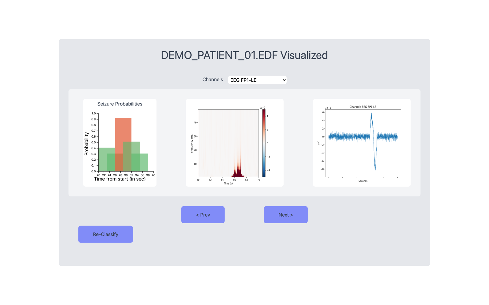
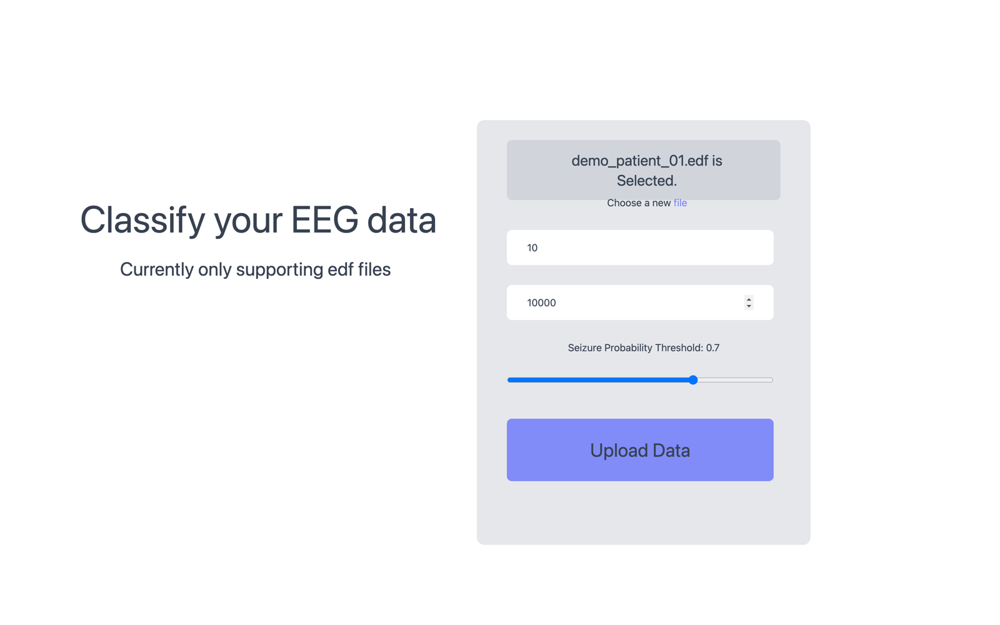
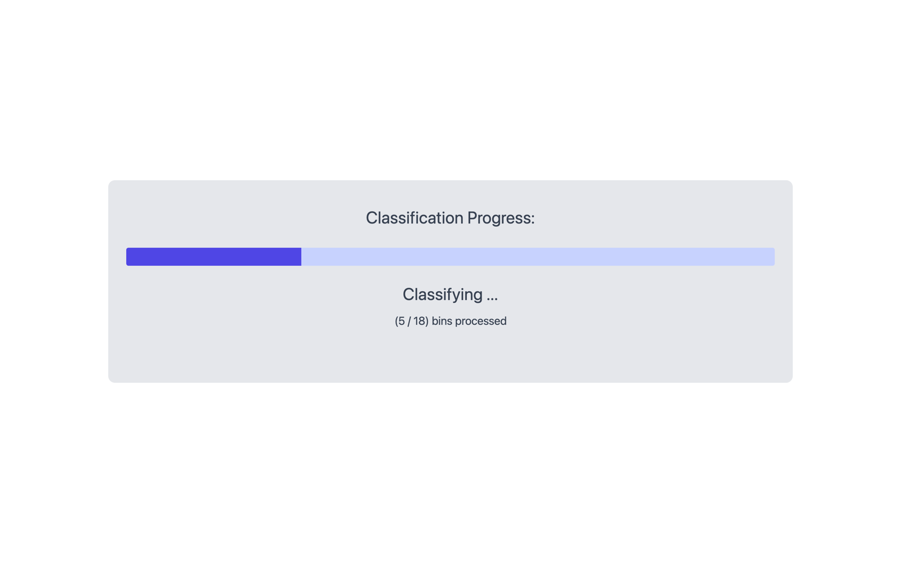
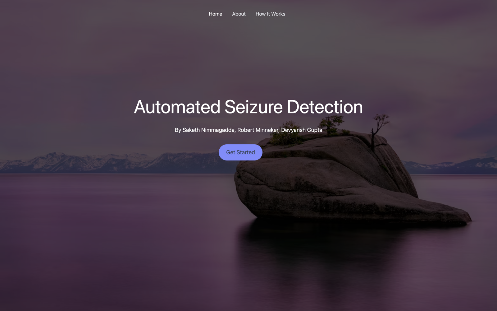

# Seizure Classification

A web tool for automated seizure detection in EEG recordings. Upload an `.edf` file, and a KNN classifier scores overlapping time windows of the recording for seizure activity — streaming progress live to the browser and visualizing every flagged window with probability charts, raw traces, and time–frequency plots.

Built as a capstone project for **CSE 481C (Neural Engineering)** at the University of Washington by Saketh Nimmagadda, Robert Minneker, and Devyansh Gupta.



*Screenshots in this README show the app classifying a demo recording assembled from the TUSZ-derived test features committed in `training/df_test_tusz.csv` — real TUSZ recordings cannot be redistributed.*

## How it works

**Upload.** A clinician selects an EEG recording (`.edf`) and chooses how the recording should be windowed: the *bin width* (1–30 s window of EEG scored at a time), the *bin spacing* (0.5–20 s stride between windows), and the *probability threshold* above which a window is flagged as a seizure.



**Classify.** The Flask backend loads the EDF with [MNE](https://mne.tools), applies a 60 Hz notch filter, downsamples, and normalizes the recording to 64 channels. Each window is split into one-second segments, averaged across channels, standardized, and scored by a K-nearest-neighbors classifier trained on the Temple University Hospital Seizure Corpus (TUSZ). The fraction of one-second segments voted "seizure" becomes the window's probability. Progress streams to the UI over Socket.IO as each window is scored.



**Review.** Every window whose probability exceeds the threshold gets a detail view: a d3 bar chart of the probabilities around the detection (colored green → red by confidence), plus a Morlet-wavelet time–frequency plot and the raw EEG trace for any channel you select. Results are cached server-side, so re-uploading the same filename jumps straight to the results.

## Repository layout

```
├── src/            React frontend (React 17, react-router, d3, Tailwind CSS)
│   ├── pages/      Landing, About, How-it-works, Upload, Progress, Results
│   └── charts/     d3 bar chart of per-window seizure probabilities
├── api/            Flask + Flask-SocketIO inference backend
│   ├── api.py                      /result, /was-cached, plot-serving routes
│   ├── inference_preprocessing.py  notch filter, downsample, 64-channel reshape
│   └── tfr_raw_psd.py              Morlet TFR + raw trace plot generation
└── training/       Offline training: notebooks, datasets, model artifacts
    ├── offline_training_new.ipynb  sklearn/XGBoost models → the deployed KNN
    ├── offline_training.ipynb      EEGNet (Keras) experiments
    ├── data_preparation.ipynb      TUSZ EDF → training arrays
    └── knn_classifier.pkl          deployed model (+ scaler_tusz.sav)
```

## Getting started

Two processes run side by side: the React dev server (port 3000) and the Flask API (port 5000).

### Prerequisites

- **Node 16** and **Yarn** — the frontend uses `react-scripts` 4, which does not run on Node 17+ (`ERR_PACKAGE_PATH_NOT_EXPORTED` from its postcss toolchain). With [nvm](https://github.com/nvm-sh/nvm): `nvm install 16 && nvm use 16 && npm install -g yarn`.
- **Python 3.9** — the pinned scientific stack (see `api/requirements.txt`) has wheels for 3.9; newer Pythons will not resolve `scikit-learn==1.0.2`.

### 1. Frontend

```bash
yarn install
yarn start          # http://localhost:3000
```

### 2. Backend (separate terminal)

```bash
cd api
python3.9 -m venv venv
source venv/bin/activate     # Windows: venv\Scripts\activate
pip install -r requirements.txt
cd ..
yarn start-api               # Flask on http://127.0.0.1:5000
```

The API loads `training/knn_classifier.pkl` and `training/scaler_tusz.sav` (both committed) at startup, so the first request is ready as soon as Flask boots.

> **macOS note:** AirPlay Receiver also listens on port 5000. Flask still binds `127.0.0.1:5000` successfully, but if your browser resolves `localhost` to the IPv6 `::1`, requests will hit AirPlay (HTTP 403) instead of Flask. If uploads never reach the API, turn off *System Settings → General → AirDrop & Handoff → AirPlay Receiver*.

### Using the tool

1. Open http://localhost:3000 and click **Get Started**.
2. Choose an `.edf` file. The recording's channel names must follow TUH-style naming and include `EEG CZ-LE`, which the plotting code uses as the EEG reference — TUSZ recordings qualify; EDFs with other montages will classify but fail during plot generation.
3. Set bin width (seconds), bin spacing (milliseconds, multiples of 500), and the seizure probability threshold.
4. Upload. When classification finishes you are redirected to the results page — pick a channel from the dropdown to render the plots, and use **Prev / Next** to step through flagged windows.

## Model and training

The deployed model is a scikit-learn KNN classifier over standardized one-second, channel-averaged EEG segments (128 samples at 128 Hz), trained on a subset of the [Temple University Hospital EEG Seizure Corpus](https://isip.piconepress.com/projects/nedc/html/tuh_eeg/) (access requires TUSZ's data use agreement; raw recordings are therefore not committed, but the derived train/test feature CSVs are). The `training/` directory also contains earlier experiments — an EEGNet-8,2 implementation in Keras with a TensorFlow Datasets builder for TUSZ, and notebooks exploring other classical models on the [Kaggle Epileptic Seizure Recognition dataset](https://www.kaggle.com/datasets/harunshimanto/epileptic-seizure-recognition) — that did not ship in the serving path.

## Known limitations

This is a research prototype from 2021, not a medical device. In particular:

- **Not clinically validated.** Outputs are model scores on windowed data, nothing more.
- **TUH-style EDFs only.** Plot generation hard-codes `EEG CZ-LE` as the reference channel and fails on other montages.
- **Pinned, dated dependencies.** The committed model was pickled with scikit-learn 0.23; a compatibility alias in `api/model_utils.py` lets it load under the pinned 1.0.2, but newer scikit-learn versions cannot unpickle it. Similarly, the API uses MNE APIs dropped in newer releases (hence the `mne==1.4.2` pin), and the frontend requires Node 16.
- **Results page quirks.** Plots render only after a channel is selected; the probability chart's x-axis assumes a fixed 5 s bin spacing rather than the values you chose; recordings are cached by filename only, so re-uploading a *different* file with the same name returns stale results.
- **No authentication and no tests.** The API serves files by relative path without restriction and should only ever run locally; `yarn test` finds no frontend tests.
- **Link-rotted artwork.** Some page imagery is hotlinked from third-party hosts and no longer resolves (most visibly the illustration cards on the How-it-works page).

## Screenshots


